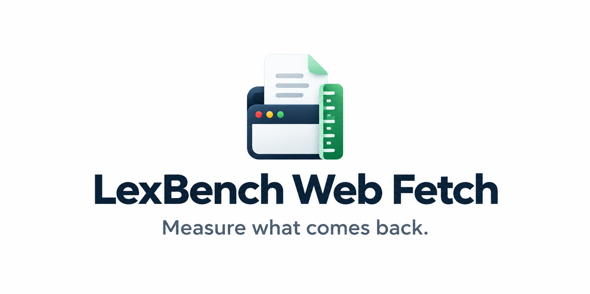
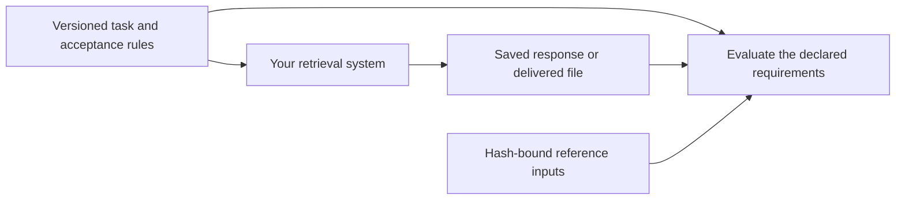

<div align="center">



[English](README.md) · [简体中文](docs/README.zh-CN.md)

[](https://github.com/lexmount/lexbench-webfetch/actions/workflows/ci.yml)
[](LICENSE)
[](pyproject.toml)

[Tasks](#task-suites) · [Quickstart](#quickstart) · [Evaluation protocol](docs/protocol.md) · [Contributing](CONTRIBUTING.md)

</div>

---

LexBench Web Fetch defines what a retrieval system must deliver: page text, named records with usable links, expected resources, or a requested file. The versioned task rules distinguish a successful request from a usable answer.

The benchmark is independent of any browser, provider or execution harness. It has no Browser Eval dependency. Use its JSON task definitions with your own runner, or export verified inputs for [Browser Eval](https://github.com/lexmount/browser-eval).



## Task suites

| Suite | Task entries | Scope |
| --- | ---: | --- |
| `webfetch` | 150 | Web pages, documents, images, video and challenge pages |
| `dynamic-content` | 100 | Content and records loaded after the initial page response |
| `popular-sites` | 100 | Task-relevant content on widely used websites |
| `access-restrictions` | 100 | URLs where access restrictions were previously observed |
| `articles` | 100 | Displayed article bodies; fixed initial comment and post coverage rules |

These are five separately versioned populations, with 550 task entries in total. They are not a deduplicated 550-site leaderboard. The access-restriction label describes historical observations; a URL may behave differently today. WebMainBench, WCXB and WebArena remain separate upstream benchmarks.

Each suite ships a readable `tasks.json`, a catalog with original task-definition hashes, and a manifest binding the exact executable dataset and reference files. See [data layout and rights](docs/data.md). Task wording and frozen acceptance rules retain their original language.

The [article suite](src/lexbench_webfetch/definitions/evaluation/articles/README.md), `articles-v11`, adds 95 fixed articles and five changing post collections. It checks displayed article content and required page components, including initial comment and post coverage, to catch title-only or body-only extraction. Fixed articles require 80% coverage in every declared body region and the reviewed ending. This tolerates formatting differences but does not prove every small module or its order. Changing comments and post lists use structural checks (record counts, attribution and nonempty text), not verification of the full contents of each record. Complete references remain outside Git.

## Quickstart

Install [uv](https://docs.astral.sh/uv/getting-started/installation/), then:

```sh
git clone https://github.com/lexmount/lexbench-webfetch.git
cd lexbench-webfetch
uv sync --frozen
uv run --frozen lexbench-webfetch list
uv run --frozen lexbench-webfetch validate
```

This checks the public definitions without a browser, API key or Browser Eval checkout. It does not fetch websites or compute benchmark scores.

To reproduce a frozen suite, obtain an approved copy of its inputs. The required files and hashes are in `src/lexbench_webfetch/definitions/registry.json`. Third-party snapshots are not redistributed here; no public download bundle is currently provided.

```sh
uv run --frozen lexbench-webfetch verify-inputs \
  --suite webfetch --source /absolute/path/approved-inputs
uv run --frozen lexbench-webfetch export \
  --suite webfetch --source /absolute/path/approved-inputs \
  --output /absolute/path/new-input-directory
```

The export includes only manifest-listed files and prints the executable dataset path. Missing files, changed bytes and symlinks fail validation. Existing output directories are never reused.

## Score a saved answer

The benchmark includes its own scorer. It needs no Browser Eval installation:

```sh
uv run --frozen lexbench-webfetch score --task examples/task.json --response examples/answer.txt
uv run --frozen lexbench-webfetch score --task examples/task.json --response examples/missing.txt
```

The first answer passes; the second fails. Use `--metadata /absolute/path/metadata.json` to include structured answer fields such as `links` or `images`; the file must contain a JSON object. Metadata cannot supply a file-acceptance verdict. Supply the complete task JSON from a verified dataset for a real result. Public task projections bind reference bodies by hash and cannot replace those complete rules. File tasks use repeated `--file /absolute/path/file` arguments; acceptance is derived from the actual bytes, signature, length and declared hash, not a supplied pass flag. Optional ordered-tree tasks require `uv sync --frozen --extra tree`.


Compile the audited access-restriction rules with independently captured references:

```sh
uv run --frozen lexbench-webfetch compile-access-restrictions \
  --evidence-home /absolute/path/reference-data-home --output /absolute/path/new-dataset.json
```

## Run an evaluation

A runner receives each task's URL and prompt, saves its response or files, and evaluates the declared requirements against the verified reference inputs. Record the benchmark commit, suite ID, input hashes, method versions, execution policy and scorer revision. Follow the [evaluation protocol](docs/protocol.md) when reporting scores or timing.

With Browser Eval installed in a separate checkout:

```sh
uv run --frozen browser-harness-eval validate \
  --dataset /absolute/path/new-input-directory/dataset.json
uv run --frozen browser-harness-eval run \
  --dataset /absolute/path/new-input-directory/dataset.json \
  --provider-config configs/providers.quickstart.json --providers http
```

Run these two commands from Browser Eval. Ordinary runs are diagnostic; a formal live-site comparison additionally requires its pre-call/post-call reference certification. The benchmark input checker verifies frozen bytes, not present-day website validity. See the [Browser Eval integration guide](https://github.com/lexmount/browser-eval/blob/main/docs/benchmarks.md).

## Scoring behavior

Version 0.3 matches Latin words at word boundaries for facts, markers and stable anchors. Required body facts use the returned content; a separate document title cannot supply missing body text. Chinese phrases retain literal matching, and numeric and currency checks keep their value boundaries.

A task can set `page_identity_required: true` to require its final URL observations. Missing or mismatched observations then fail acceptance. Dynamic tasks can also set `document_language_match: "exact"` when the complete language tag matters; the default is `"primary"`. These checks apply across interfaces. Frozen tasks that do not require URL metadata keep their content-based acceptance rules.

Offline scoring recomputes derived fields. It retains the original reference hash, deadline evidence and file fingerprints. A file verdict requires current file verification; an old pass flag cannot certify a rescore. Summaries expose `mean_all_attempts_ms`, `all_attempts_p50_ms` and `all_attempts_p95_ms` alongside the existing successful-call timings. The all-attempt population includes failed calls and timeouts.

These changes do not revise frozen tasks or certify historical results. Score corrections require a new evidence revision tied to the scorer and its regression controls.

## Repository contents

| Path | Purpose |
| --- | --- |
| `src/lexbench_webfetch/definitions/` | Task definitions, catalogs and frozen input manifests |
| `src/lexbench_webfetch/benchmark.py` | Independent definition checks and verified input export |
| `src/lexbench_webfetch/scoring.py` | Authoritative task acceptance and content diagnostics |
| `src/lexbench_webfetch/risk_control_dataset.py` | Compile audited access-restriction task requirements |
| `docs/protocol.md` | Acceptance, evidence, timing and result-reporting rules |
| `tests/` | Accepted/rejected input scenarios and export behavior |

Browser adapters, credentials, measured runs, report renderers and hosting configuration belong to the execution harness or its evidence storage. This repository owns task models, deterministic acceptance scoring, file-byte checks and task compilation. Browser Eval imports these implementations as a pinned dependency. This repository publishes no measured leaderboard.

## Contribute

Read [CONTRIBUTING](CONTRIBUTING.md) before changing a task or proposing a result. Run `make check` to validate the definitions and test the input tools. Report security issues through [SECURITY](SECURITY.md).

Project-owned code and definitions use the [MIT license](LICENSE); third-party source material retains its own terms, described in [THIRD_PARTY](THIRD_PARTY.md).

## Cite LexBench Web Fetch

If you use the task definitions or scoring tools in published work, cite this repository and record the exact commit and suite used. GitHub's citation menu reads [CITATION.cff](CITATION.cff). For version 0.3.0:

```bibtex
@software{lexbench_webfetch_2026,
  author = {{LexBench Web Fetch contributors}},
  title = {LexBench Web Fetch},
  year = {2026},
  version = {0.3.0},
  url = {https://github.com/lexmount/lexbench-webfetch}
}
```

Cite [Browser Eval](https://github.com/lexmount/browser-eval#cite-browser-eval) separately when using its execution harness, and cite upstream sources or benchmarks according to their attribution terms. This repository citation does not replace those citations. When using another version, update the version and year in the example and identify its tag or commit.
